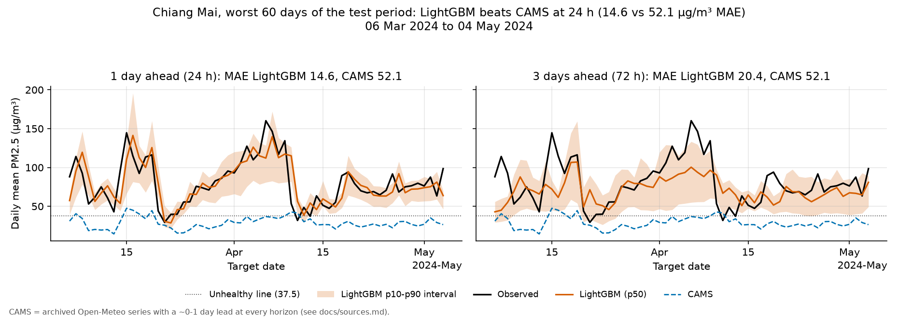
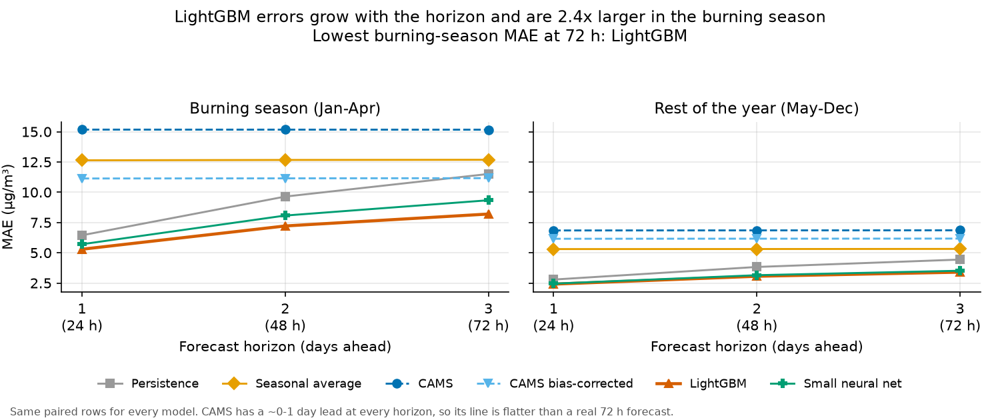
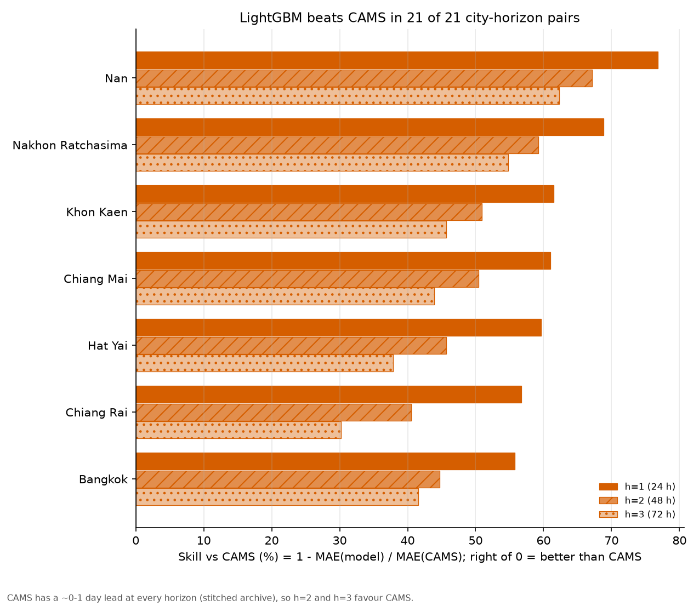

# Thai Air Forecast

**Can a small model I own beat the professional CAMS (Copernicus) air-quality forecast?** This repo forecasts daily mean PM2.5 for 7 Thai cities 1, 2 and 3 days ahead, and tests that question on three burning seasons of held-out data.



<!-- RESULTS:headline -->
TODO(lead): filled from reports/results.md by `python -m thaiair.report --fill-readme`.
<!-- /RESULTS -->

## Why

Every year from January to April, northern and central Thailand fill with smoke. Farmers burn crop waste, forests burn, and the air stays still. Chiang Mai often has some of the worst air in the world during these months. Fine dust (PM2.5) goes deep into the lungs. On bad days Thai health agencies tell people to stay inside and some schools close.

A good forecast for the next few days lets people plan: keep children inside, buy masks, move an outdoor event. A professional forecast already exists. The Copernicus Atmosphere Monitoring Service (CAMS) runs a global chemistry and weather model and publishes PM2.5 forecasts for every point on Earth.

I want to know whether a **small model I own** can do better for these cities, using only free public data: city ground stations, archived weather forecasts, and CAMS itself as an input. The model runs on a laptop CPU, trains in minutes and costs nothing to serve. The alternative is to rent or depend on a big professional service. If the small model wins, owning it is worth it. If it loses, that is also a useful answer, and this README says so.

## Setup

- **Target:** daily mean PM2.5 (µg/m³) for each city, per local calendar day (Asia/Bangkok). A city's value is the median of a few long-running Air4Thai stations.
- **Issue time:** the end of day `t`. The model may use everything observed up to and including day `t`.
- **Horizons:** `h = 1, 2, 3` days, so the target is day `t + h` (24, 48 and 72 h ahead).
- **Cities (7):** Bangkok, Chiang Mai, Chiang Rai, Nan, Khon Kaen, Nakhon Ratchasima, Hat Yai.
- **Backtest:** rolling origin. At the start of each month the models are refit on every day whose target was already observed, then forecast that month. Nothing from the future is used.
- **Test window:** October 2023 to June 2026, which holds three burning seasons (2024, 2025, 2026).
- **Models:** two simple baselines (persistence: "tomorrow = today"; seasonal average: "what this week of the year usually looks like"), raw CAMS, CAMS with a per-city bias correction, LightGBM with quantiles (p10/p50/p90), and a small PyTorch quantile network.
- **Alerts:** an "unhealthy day" is a daily mean above 37.5 µg/m³ (Thai AQI orange or worse).

**An honest caveat about CAMS.** The free CAMS archive (via Open-Meteo) keeps only the most recent run for each past hour. So the archived CAMS value for day `t + 3` was issued around day `t + 3`, not 72 hours before. In this comparison CAMS always has a lead of about 0 to 1 day, while my models must forecast a true 24, 48 or 72 hours ahead. At h = 2 and h = 3 the comparison favours CAMS. A win there is a conservative result. A loss there may be partly due to the head start. See [docs/sources.md](docs/sources.md).

## Results

All numbers are on held-out months (rolling origin, Oct 2023 to Jun 2026). Every model is scored on the same rows: the (city, horizon, issue date) cases where every model and CAMS have a forecast and the truth is known. Full tables, by city too: [reports/results.md](reports/results.md).

### 1. Error by horizon

<!-- RESULTS:by_horizon -->
TODO(lead): MAE / RMSE by horizon table.
<!-- /RESULTS -->

### 2. Burning season vs the rest of the year

<!-- RESULTS:by_season -->
TODO(lead): burning vs rest table.
<!-- /RESULTS -->



### 3. Skill vs CAMS

<!-- RESULTS:skill -->
TODO(lead): skill vs CAMS by horizon and season.
<!-- /RESULTS -->



**Where CAMS wins** (generated, so the losses cannot be left out):

<!-- RESULTS:cams_wins -->
TODO(lead): auto-generated list of groups with skill < 0.
<!-- /RESULTS -->

### 4. Unhealthy-day alerts

<!-- RESULTS:alerts -->
TODO(lead): events, precision, recall, F1 per model and horizon.
<!-- /RESULTS -->

### 5. Are the intervals honest?

<!-- RESULTS:coverage -->
TODO(lead): p10-p90 coverage and width.
<!-- /RESULTS -->

### Takeaways

- TODO(lead): the headline answer in one sentence: does the best own model beat CAMS at 24 h, and at 48/72 h (with the caveat)?
- TODO(lead): how much harder the burning season is, and which model holds up best there.
- TODO(lead): how hard persistence is to beat at h = 1, and what that says about PM2.5.
- TODO(lead): does LightGBM beat the cheap fix (CAMS bias-corrected)? Does the neural net add anything over LightGBM?
- TODO(lead): alert trade-off: who catches the most unhealthy days, and at what false-alarm cost.
- TODO(lead): interval coverage vs the 80% target.
- TODO(lead): the city where CAMS is hardest to beat, and a guess why (with evidence, or say it is a guess).

## Try it

```bash
py -3.12 -m venv .venv
.venv\Scripts\activate
pip install --extra-index-url https://download.pytorch.org/whl/cpu -e ".[deep,viz,demo,dev]"
```

On Windows set `PYTHONPATH=src;.` (Linux/macOS: `src:.`), then:

```bash
# API: GET /health, GET /cities, GET /forecast?city=chiang_mai, GET /backtest?city=chiang_mai&horizon=1
python -m uvicorn app.api:app --port 8000
curl "http://127.0.0.1:8000/forecast?city=chiang_mai"

# Dashboard: live 3-day map for the 7 cities, and the backtest against CAMS
python -m streamlit run app/dashboard.py

# Tests and lint
python -m pytest
ruff check .
```

Docker (API only, CPU, LightGBM): `docker build -t thai-air-forecast .` then `docker run -p 8000:8000 thai-air-forecast`.

The live forecast pulls today's data from Air4Thai, Open-Meteo and CAMS (all free, no API key). The app loads the trained models from `models/`. If they are missing it falls back to a clearly labelled persistence forecast, so it always starts.

A [GitHub Action](.github/workflows/daily-forecast.yml) runs the live forecast for all 7 cities every morning (08:30 Bangkok time) and saves it as a downloadable artifact. It commits nothing back to the repo.

A `Makefile` wraps the common commands (`make data backtest train report api dashboard test`).

## Reproduce from scratch

```bash
python -m thaiair.pm25       # Air4Thai daily files 2019-2026 + recent hourly -> data/processed/pm25_daily.parquet
python -m thaiair.weather    # ERA5 past weather + archived JMA forecasts -> weather_past / weather_fc
python -m thaiair.cams       # CAMS PM2.5 archive -> cams_daily.parquet
python -m thaiair.evaluate   # rolling-origin backtest of every model -> reports/backtest_predictions.parquet
python -m thaiair.train      # final models on all data -> models/*.joblib + manifest.json
python -m thaiair.report     # reports/results.md + reports/figures/*.png (add --fill-readme to update this file)
```

Raw downloads are cached in `data/raw/` (git-ignored), so a re-run makes no new calls. Everything here runs on a laptop CPU, no GPU.

## Data

All sources are free and need no API key. Details, coverage and licences: [docs/sources.md](docs/sources.md). Cleaning: [docs/cleaning.md](docs/cleaning.md). Weather and CAMS: [docs/weather_cams.md](docs/weather_cams.md).

| What | Source | Licence / terms |
|---|---|---|
| Ground-truth PM2.5 (daily 2019 to Jun 2026, hourly for the last ~2 months) | Thai Pollution Control Department, [Air4Thai](https://air4thai.pcd.go.th) | No licence stated; Thai government data. Credited here; raw files are not redistributed, `thaiair.pm25` downloads them. |
| Past weather (observed) | ERA5 reanalysis via [Open-Meteo](https://open-meteo.com) | CC BY 4.0 (Open-Meteo); Copernicus licence (ERA5) |
| Weather forecasts as they were issued | JMA GSM via the Open-Meteo Previous Runs API | CC BY 4.0 |
| CAMS PM2.5 forecast (the baseline to beat) | Copernicus Atmosphere Monitoring Service via the Open-Meteo Air Quality API | CC BY 4.0 + "Generated using Copernicus Atmosphere Monitoring Service information" |

Weather data by Open-Meteo.com. Contains Copernicus Atmosphere Monitoring Service information.

## Limitations

- **Daily, not hourly.** There is no public multi-year hourly archive of Thai station data (the hourly service keeps only about 2 months), so the model forecasts the daily mean. Thai AQI for PM2.5 uses the 24 h mean anyway, but hourly peaks are not covered.
- **The CAMS comparison is tilted towards CAMS** at 48 and 72 h, because the archive is a stitched series with a 0 to 1 day lead (see above). The bias-corrected CAMS baseline uses the same archived value, so it shares the head start: at h = 2 and 3 it is not a model you could run live with the same inputs.
- **A city is a few stations.** Each city value is the median of 1 to 9 stations. Chiang Rai, Nan, Khon Kaen, Nakhon Ratchasima and Hat Yai have one station each, so one broken sensor moves the whole city.
- **No fire data.** NASA FIRMS hotspot counts would likely help in the burning season, but the API needs a key, so they are not used.
- **A gap in July to August 2026.** The yearly PCD file ends on 30 June 2026 and the hourly service starts on 1 September 2026. It falls in the rainy season and outside the backtest.
- **Coarse weather forecasts.** The only model with a multi-year forecast archive is JMA's global model, which is coarse for mountain valleys like Chiang Mai. Boundary-layer height is only in ERA5, so it is used as a lagged (observed) feature only.
- **Live features differ slightly from training.** The live app uses the freshest forecast run and the forecast API's recent weather, while training used archived runs and ERA5. The live forecast may be a little better or worse than the backtest suggests.
- **One country, three seasons.** Three burning seasons is a small sample of bad years. The results may not hold in a very different year or another country.

## Layout

```
src/thaiair/   data (pm25, weather, cams), dataset + features, baselines, backtest, metrics, report, live
src/thaiair/models/   LightGBM quantile model, small PyTorch net, saved-model registry
app/           FastAPI service + Streamlit dashboard
models/        trained models used by the app
reports/       results.md, figures, backtest predictions
docs/          architecture (the interface contract), data sources, cleaning, weather + CAMS notes
tests/         unit tests (no network, synthetic data; run in CI)
.github/       CI and the daily forecast Action
LEARN.md       the ideas behind the project, explained simply, with a quiz and exercises
```

Built with AI assistance (Claude Code).
