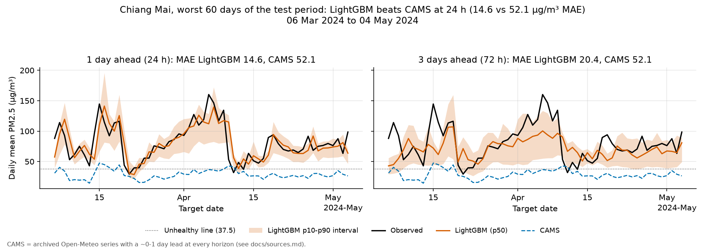
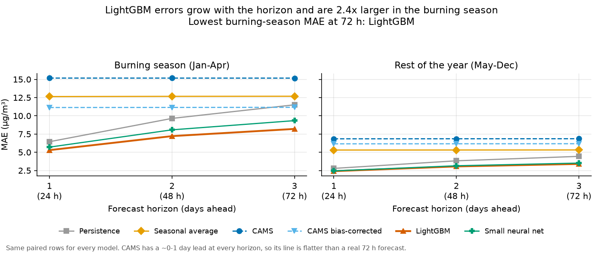
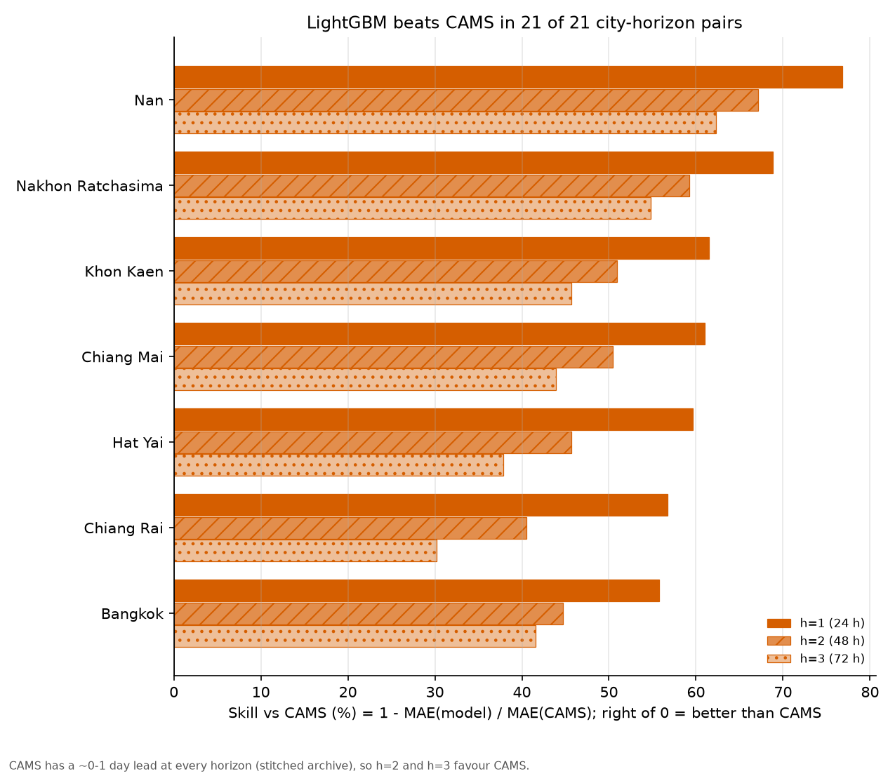

# Backtest results

Generated by `python -m thaiair.report` from the backtest predictions. Do not edit by hand.
Every number is on held-out months, and every model is scored on the same rows (see below).

- Issue dates: 2023-10-01 to 2026-06-29 (rolling origin, refit every month, train only on days before the month starts)
- Cities: Bangkok, Chiang Mai, Chiang Rai, Nan, Khon Kaen, Nakhon Ratchasima, Hat Yai
- Models: Persistence (`persistence`), Seasonal average (`seasonal`), CAMS (`cams`), CAMS bias-corrected (`cams_bc`), LightGBM (`lgbm`), Small neural net (`deep`)
- Best own model (used in the figures): LightGBM
- Rows in the predictions file: 126,504; paired rows used here: 124,524

## Headline

<!-- RESULTS:headline -->
On 20,754 paired forecasts, at h=1 LightGBM MAE is 3.4 µg/m³ vs 9.8 for CAMS (skill +65%); at h=3 LightGBM MAE is 5.1 µg/m³ vs 9.9 for CAMS (skill +48%). In the burning season (Jan-Apr) at h=1: 5.3 vs 15.2 (skill +65%).
<!-- /RESULTS -->

## 1. Error by horizon

<!-- RESULTS:by_horizon -->
| Model | MAE h=1 | MAE h=2 | MAE h=3 | RMSE h=1 | RMSE h=2 | RMSE h=3 |
|:---|---:|---:|---:|---:|---:|---:|
| Persistence | 4.1 | 5.9 | 7.0 | 7.1 | 10.1 | 11.7 |
| Seasonal average | 7.9 | 8.0 | 8.0 | 12.8 | 12.9 | 12.9 |
| CAMS† | 9.8 | 9.9 | 9.9 | 15.5 | 15.5 | 15.5 |
| CAMS bias-corrected | 8.0 | 8.0 | 8.0 | 12.2 | 12.2 | 12.2 |
| LightGBM | **3.4** | **4.6** | **5.1** | **5.8** | **7.5** | **8.5** |
| Small neural net | 3.6 | 4.9 | 5.6 | 6.2 | 8.2 | 9.6 |

µg/m³, lower is better, best in bold. Paired rows per horizon: h=1: 6,928, h=2: 6,918, h=3: 6,908.

† CAMS is the Open-Meteo archive, a stitched series of the most recent CAMS run, so its real lead time is about 0-1 day at every horizon. Our models forecast a true 24/48/72 h ahead, so at h=2 and h=3 the comparison favours CAMS (see docs/sources.md). CAMS bias-corrected is built on the same archived value, so it shares this head start.
<!-- /RESULTS -->

## 2. Error by city

<!-- RESULTS:by_city -->
**h=1 (24 h ahead), MAE µg/m³**

| City | n | Persistence | Seasonal average | CAMS | CAMS bias-corrected | LightGBM | Small neural net |
|:---|---:|---:|---:|---:|---:|---:|---:|
| Bangkok | 1,003 | 4.3 | 6.1 | 7.6 | 5.8 | **3.4** | 3.6 |
| Chiang Mai | 1,003 | 4.1 | 9.2 | 9.4 | 10.0 | **3.6** | 3.9 |
| Chiang Rai | 995 | 4.9 | 9.9 | 9.5 | 10.0 | **4.1** | 4.4 |
| Nan | 950 | 4.5 | 10.7 | 18.1 | 10.1 | 4.2 | **4.1** |
| Khon Kaen | 998 | 5.2 | 8.1 | 10.5 | 8.1 | **4.0** | 4.2 |
| Nakhon Ratchasima | 995 | 4.2 | 6.7 | 10.3 | 8.3 | **3.2** | 3.5 |
| Hat Yai | 984 | 1.6 | 5.1 | 3.9 | 3.4 | **1.6** | 1.6 |

**h=3 (72 h ahead), MAE µg/m³**

| City | n | Persistence | Seasonal average | CAMS | CAMS bias-corrected | LightGBM | Small neural net |
|:---|---:|---:|---:|---:|---:|---:|---:|
| Bangkok | 1,001 | 6.9 | 6.1 | 7.6 | 5.8 | **4.5** | 5.2 |
| Chiang Mai | 1,001 | 7.1 | 9.2 | 9.4 | 10.1 | **5.3** | 5.9 |
| Chiang Rai | 993 | 8.6 | 9.9 | 9.6 | 10.0 | **6.7** | 7.1 |
| Nan | 944 | 8.6 | 10.8 | 18.1 | 10.1 | **6.8** | 7.2 |
| Khon Kaen | 996 | 8.1 | 8.1 | 10.5 | 8.2 | **5.7** | 6.1 |
| Nakhon Ratchasima | 993 | 7.0 | 6.7 | 10.3 | 8.3 | **4.7** | 5.4 |
| Hat Yai | 980 | 2.7 | 5.1 | 3.9 | 3.4 | **2.4** | 2.5 |
<!-- /RESULTS -->

## 3. Burning season vs the rest of the year

<!-- RESULTS:by_season -->
| Model | Burning h=1 | Burning h=2 | Burning h=3 | Rest h=1 | Rest h=2 | Rest h=3 |
|:---|---:|---:|---:|---:|---:|---:|
| Persistence | 6.4 | 9.6 | 11.5 | 2.8 | 3.8 | 4.4 |
| Seasonal average | 12.6 | 12.7 | 12.7 | 5.3 | 5.3 | 5.3 |
| CAMS | 15.2 | 15.2 | 15.2 | 6.8 | 6.8 | 6.9 |
| CAMS bias-corrected | 11.1 | 11.1 | 11.2 | 6.2 | 6.2 | 6.2 |
| LightGBM | **5.3** | **7.2** | **8.2** | **2.4** | **3.1** | **3.4** |
| Small neural net | 5.7 | 8.1 | 9.3 | 2.5 | 3.1 | 3.5 |

MAE µg/m³, best in bold. Burning season = target day in Jan, Feb, Mar, Apr. Paired rows at h=1: burning 2,498, rest 4,430. Mean observed PM2.5: burning 38.1, rest 16.9 µg/m³.
<!-- /RESULTS -->

## 4. Unhealthy-day alerts

<!-- RESULTS:alerts -->
| Model | h | Events | Alerts | Precision | Recall | F1 |
|:---|---:|---:|---:|---:|---:|---:|
| Persistence | 1 | 1,112 | 1,112 | 0.79 | 0.79 | 0.79 |
| Seasonal average | 1 | 1,112 | 1,354 | 0.58 | 0.71 | 0.64 |
| CAMS | 1 | 1,112 | 532 | 0.70 | 0.34 | 0.46 |
| CAMS bias-corrected | 1 | 1,112 | 844 | 0.71 | 0.54 | 0.61 |
| LightGBM | 1 | 1,112 | 1,108 | 0.84 | 0.84 | **0.84** |
| Small neural net | 1 | 1,112 | 1,238 | 0.79 | 0.88 | 0.83 |
| Persistence | 2 | 1,112 | 1,112 | 0.70 | 0.70 | 0.70 |
| Seasonal average | 2 | 1,112 | 1,354 | 0.58 | 0.71 | 0.64 |
| CAMS | 2 | 1,112 | 532 | 0.70 | 0.34 | 0.46 |
| CAMS bias-corrected | 2 | 1,112 | 843 | 0.71 | 0.54 | 0.61 |
| LightGBM | 2 | 1,112 | 1,110 | 0.77 | 0.77 | **0.77** |
| Small neural net | 2 | 1,112 | 1,202 | 0.74 | 0.80 | 0.77 |
| Persistence | 3 | 1,111 | 1,111 | 0.65 | 0.65 | 0.65 |
| Seasonal average | 3 | 1,111 | 1,355 | 0.58 | 0.71 | 0.64 |
| CAMS | 3 | 1,111 | 532 | 0.70 | 0.34 | 0.46 |
| CAMS bias-corrected | 3 | 1,111 | 842 | 0.71 | 0.54 | 0.61 |
| LightGBM | 3 | 1,111 | 1,102 | 0.75 | 0.75 | **0.75** |
| Small neural net | 3 | 1,111 | 1,187 | 0.72 | 0.77 | 0.74 |

An event is an observed daily mean above 37.5 µg/m³ (Thai AQI orange or worse). An alert is a p50 forecast above the same line. Precision = share of alerts that were real; recall = share of events that got an alert. Best F1 per horizon in bold.
<!-- /RESULTS -->

## 5. Prediction intervals (p10-p90)

<!-- RESULTS:coverage -->
| Model | h | n | Coverage | Burning | Rest | Width |
|:---|---:|---:|---:|---:|---:|---:|
| Persistence | 1 | 6,928 | 83% | 80% | 84% | 13.6 |
| Persistence | 2 | 6,918 | 82% | 78% | 84% | 19.6 |
| Persistence | 3 | 6,908 | 82% | 78% | 84% | 23.3 |
| Seasonal average | 1 | 6,928 | 75% | 75% | 76% | 23.4 |
| Seasonal average | 2 | 6,918 | 75% | 75% | 76% | 23.4 |
| Seasonal average | 3 | 6,908 | 75% | 75% | 75% | 23.4 |
| CAMS | 1 | 6,928 | 78% | 84% | 75% | 30.1 |
| CAMS | 2 | 6,918 | 78% | 84% | 75% | 30.1 |
| CAMS | 3 | 6,908 | 78% | 84% | 75% | 30.1 |
| CAMS bias-corrected | 1 | 6,928 | 76% | 81% | 74% | 25.8 |
| CAMS bias-corrected | 2 | 6,918 | 76% | 81% | 74% | 25.9 |
| CAMS bias-corrected | 3 | 6,908 | 76% | 81% | 74% | 25.9 |
| LightGBM | 1 | 6,928 | 82% | 82% | 82% | 11.5 |
| LightGBM | 2 | 6,918 | 82% | 80% | 83% | 15.3 |
| LightGBM | 3 | 6,908 | 81% | 80% | 82% | 17.0 |
| Small neural net | 1 | 6,928 | 80% | 82% | 78% | 12.5 |
| Small neural net | 2 | 6,918 | 75% | 76% | 75% | 15.0 |
| Small neural net | 3 | 6,908 | 72% | 67% | 75% | 14.4 |

A p10-p90 interval should contain the truth 80% of the time. Below 80% = overconfident, above = too wide. Width = mean p90 - p10 in µg/m³ (narrower is better only if coverage holds).
<!-- /RESULTS -->

## 6. Skill vs CAMS by horizon and season

<!-- RESULTS:skill -->
| Model | h=1 burning | h=1 rest | h=2 burning | h=2 rest | h=3 burning | h=3 rest |
|:---|---:|---:|---:|---:|---:|---:|
| Persistence | **+58%** | **+59%** | **+36%** | **+44%** | **+24%** | **+35%** |
| Seasonal average | **+17%** | **+22%** | **+17%** | **+22%** | **+16%** | **+22%** |
| CAMS† | ref (15.2) | ref (6.8) | ref (15.2) | ref (6.8) | ref (15.2) | ref (6.9) |
| CAMS bias-corrected | **+27%** | **+10%** | **+27%** | **+10%** | **+26%** | **+10%** |
| LightGBM | **+65%** | **+65%** | **+52%** | **+55%** | **+46%** | **+50%** |
| Small neural net | **+62%** | **+64%** | **+47%** | **+54%** | **+38%** | **+49%** |

Skill = 1 - MAE(model) / MAE(CAMS) on the same rows. Positive (bold) = better than CAMS. The CAMS row shows its own MAE in µg/m³.

† CAMS is the Open-Meteo archive, a stitched series of the most recent CAMS run, so its real lead time is about 0-1 day at every horizon. Our models forecast a true 24/48/72 h ahead, so at h=2 and h=3 the comparison favours CAMS (see docs/sources.md). CAMS bias-corrected is built on the same archived value, so it shares this head start. A positive skill at h=2/3 is therefore a conservative result; a negative one may be partly due to the lead-time gap.
<!-- /RESULTS -->

## 7. Where CAMS wins

<!-- RESULTS:cams_wins -->
- **Persistence**: CAMS wins in 0 of 6 horizon-season groups and 0 of 21 city-horizon groups.
- **Seasonal average**: CAMS wins in 0 of 6 horizon-season groups and 6 of 21 city-horizon groups.
- **CAMS bias-corrected**: CAMS wins in 0 of 6 horizon-season groups and 6 of 21 city-horizon groups.
  - Chiang Mai, h=3: skill -7% (MAE 10.1 vs CAMS 9.4)
  - Chiang Mai, h=2: skill -7% (MAE 10.1 vs CAMS 9.4)
  - Chiang Mai, h=1: skill -7% (MAE 10.0 vs CAMS 9.4)
  - Chiang Rai, h=3: skill -5% (MAE 10.0 vs CAMS 9.6)
  - Chiang Rai, h=2: skill -4% (MAE 10.0 vs CAMS 9.5)
  - Chiang Rai, h=1: skill -4% (MAE 10.0 vs CAMS 9.5)
- **LightGBM**: CAMS wins in 0 of 6 horizon-season groups and 0 of 21 city-horizon groups.
- **Small neural net**: CAMS wins in 0 of 6 horizon-season groups and 0 of 21 city-horizon groups.

Read this with the CAMS caveat: CAMS is the Open-Meteo archive, a stitched series of the most recent CAMS run, so its real lead time is about 0-1 day at every horizon. Our models forecast a true 24/48/72 h ahead, so at h=2 and h=3 the comparison favours CAMS (see docs/sources.md). CAMS bias-corrected is built on the same archived value, so it shares this head start.
<!-- /RESULTS -->

## Figures

